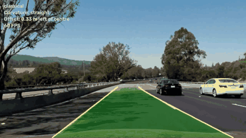
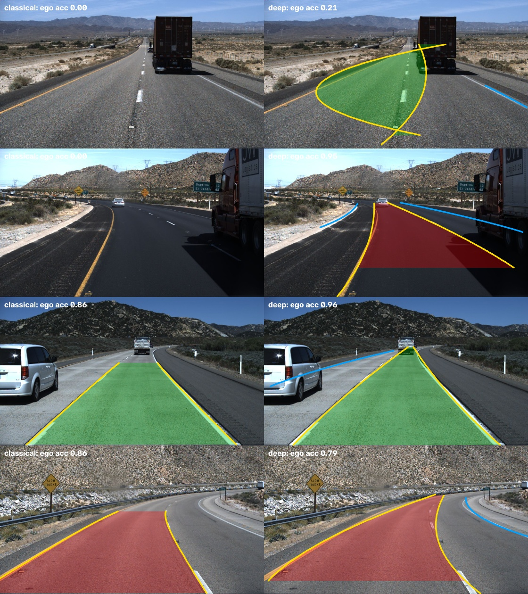
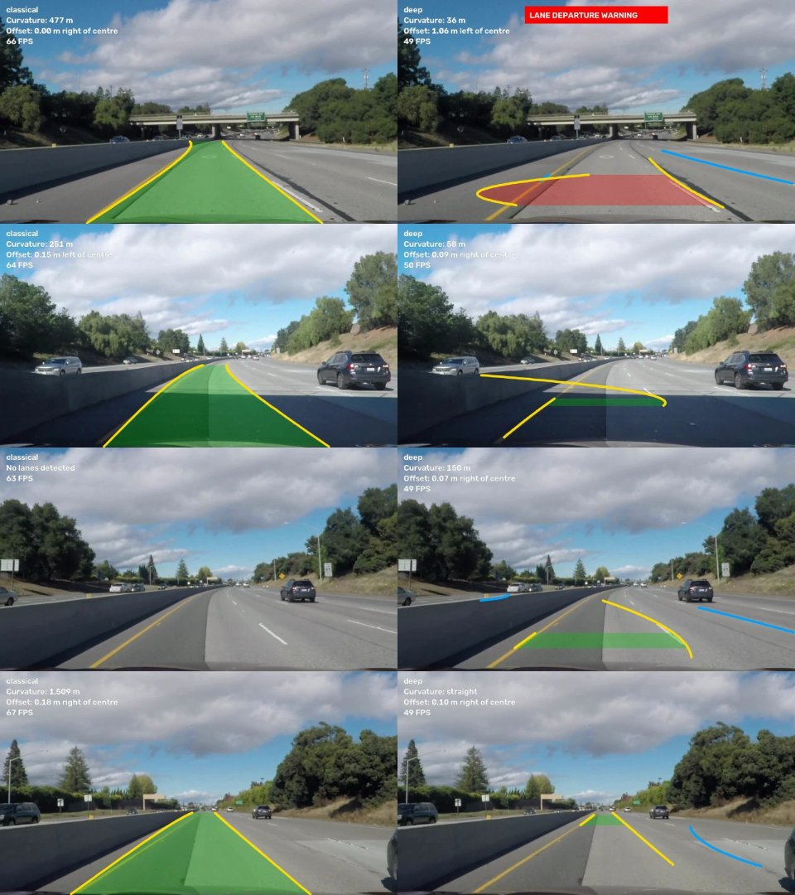
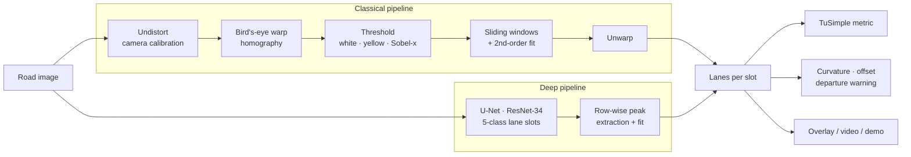

<div align="center">

# Lane Detection: Classical CV vs. Deep Learning

The same problem solved twice, a hand-engineered OpenCV pipeline and a U-Net lane segmentation network, and scored head to head with the TuSimple benchmark metric.

[](https://github.com/haroonkhan02/lane-detection-classical-vs-deep/actions/workflows/ci.yml)


[](https://huggingface.co/spaces/haroonx02/lane-detection-browser)



<sub>Classical pipeline on the Udacity project video: lane area, curvature radius and offset from the lane centre.</sub>

</div>

## What it does

- Classical pipeline: chessboard camera calibration, a bird's-eye homography, colour and gradient thresholds, sliding windows and a polynomial fit per lane.
- Deep pipeline: a U-Net with a pretrained ResNet-34 encoder that labels each pixel with its lane slot (ego-left, ego-right or one of the outer lanes).
- Both return lanes in the same format, so they share the metric, curvature/offset measurement, lane-departure warning, video tool and a Gradio demo that shows them side by side.
- Fair comparison: classical parameters are tuned on train, the network checkpoint is picked on val, and both are scored once on the full TuSimple test set.
- The network is exported to ONNX (FP32, FP16, INT8) and CoreML, and the INT8 model runs entirely in the browser in a [static Hugging Face Space](https://huggingface.co/spaces/haroonx02/lane-detection-browser).

## Results

TuSimple test set (2,782 images). Time per frame includes pre- and post-processing on an Apple M5 (classical on CPU, deep on MPS).

| Method | Ego acc | Ego FP | Ego FN | All-lanes acc | All FP | All FN | ms / frame |
|---|---|---|---|---|---|---|---|
| Classical (tuned on 1,000 train images) | 0.773 | 0.330 | 0.395 | 0.541 | 0.329 | 0.634 | 9.8 |
| U-Net ResNet-34 (30 epochs, 3,268 images) | 0.951 | 0.053 | 0.051 | 0.950 | 0.049 | 0.062 | 20.7 |

Ego means the two lanes bounding the car's lane, which is what lane keeping needs and all the classical pipeline looks for. All lanes is the standard TuSimple protocol, where the classical method scores low by design.

On its home domain the network is much better: false positives and negatives drop from 33–40 % to about 5 %, mostly because faint dashes and Botts' dots defeat fixed thresholds. The classical pipeline is twice as fast, needs no training data, and every failure can be traced in its debug views. More data helped the network more than more epochs: trained on a 233-image subset for 60 epochs it reached 0.914 ego accuracy on that subset's test split ([`reports/subset/`](reports/subset)).

<p align="center"></p>
<p align="center"><sub>Hardest and median test cases, classical left, network right. Row 1 shows the network's failure mode: a lane hidden by a truck gets a hooked polynomial fit.</sub></p>

Neither method holds up off-domain. On Udacity's challenge video (different camera, shadows, asphalt seams) the classical pipeline locks onto a dark seam next to the barrier, and the network (here the subset-trained model) produces unstable curves and a false departure warning:

<p align="center"></p>

Per-epoch training history and raw metrics are in [`reports/`](reports).

## Export and in-browser demo

The exported graph includes the ImageNet normalisation and the softmax, so a client only resizes the image and divides by 255. Every variant was re-scored on the full test set and timed on the M5 (network only, median of 100 runs):

| Variant | Size | Ego acc | Ego FP | Latency |
|---|---|---|---|---|
| PyTorch FP32 | 98 MB | 0.951 | 0.053 | 14.9 ms MPS · 71.5 ms CPU |
| ONNX FP32 / FP16 | 98 / 49 MB | 0.951 | 0.053 | 39.0 / 37.2 ms (onnxruntime CPU) |
| ONNX INT8 (static, QDQ) | 25 MB | 0.950 | 0.056 | 34.7 ms (onnxruntime CPU) |
| CoreML FP32 / FP16 | 98 / 49 MB | 0.951 | 0.053 | 9.6 / 3.7 ms (GPU / Neural Engine) |

FP32 and FP16 exports change nothing measurable. INT8 costs 0.001 ego accuracy at a quarter of the size; on 2 of 100 parity images it finds a different set of lanes. CoreML FP16 on the Neural Engine is four times faster than PyTorch on the GPU, but because it computes everything in half precision the lane points move by a median 8 px, still inside TuSimple's 20 px tolerance.

The browser demo runs the INT8 model with onnxruntime-web (WebAssembly, 4 threads) at about 210 ms per frame in Chrome on the M5. The resize, lane extraction and polynomial fit are ported to JavaScript; on 200 test frames the JavaScript pipeline found the same lanes as Python, with a median shift under 0.01 px and the same ego-lane accuracy. Details: [`reports/export.md`](reports/export.md), [`reports/benchmark.md`](reports/benchmark.md), [`reports/web_parity.json`](reports/web_parity.json).

## How it works



The classical detector warps the road to a top-down view where lanes are parallel, thresholds white (adaptive lightness percentile), yellow (LAB b channel) and horizontal gradients, then follows each lane upward with sliding windows and fits `x = Ay² + By + C`. In video it searches around the previous fit and coasts through a few bad frames.

The network is trained with weighted cross-entropy plus Dice, because lane pixels are about 2 % of the image. Lanes are recovered from each row's probability-weighted peak per slot and a low-order polynomial fit.

## Getting started

```bash
git clone https://github.com/haroonkhan02/lane-detection-classical-vs-deep.git
cd lane-detection-classical-vs-deep
uv venv --python 3.12 && source .venv/bin/activate
uv pip install -e ".[demo,dev]"

lanes-download udacity     # chessboards, test images, videos (~30 MB)
lanes-download kaggle      # full TuSimple via ~/.kaggle/kaggle.json (23 GB zip, keeps ~1.2 GB)

lanes-calibrate data/udacity/camera_cal -o models/udacity_calibration.npz
python -m lanedet.classical.tune --root data/tusimple_full --limit 1000 \
    --output configs/tusimple_full.yaml
lanes-train --root data/tusimple_full --epochs 30 --output models/unet_resnet34_full.pt
lanes-evaluate             # both methods on test, writes reports/
lanes-demo                 # Gradio app
```

To try the demo without training, run `lanes-demo` straight after install: it downloads the published weights from [Hugging Face](https://huggingface.co/haroonx02/lane-detection-unet-resnet34). `space/` packages the same Gradio demo as a Space.

For the exports, `uv pip install -e ".[export]"`, then `lanes-export` (all variants, re-scored on test) and `lanes-benchmark`; `scripts/web_parity.py` checks the JavaScript port and `scripts/deploy_static_space.py --models` publishes `web/`.

`lanes-video data/udacity/project_video.mp4 --method classical --config configs/udacity.yaml --calibration models/udacity_calibration.npz -o outputs/project_classical.mp4` annotates a video. Training takes about 100 minutes on an M5. The original TuSimple links are dead; without a Kaggle account, `lanes-download tusimple --split train|val|test` fetches the ~500-clip public mirror instead.

Tests run on synthetic roads with no dataset or GPU: `pytest` (41 tests) and `ruff check .`.

## Repository structure

```text
lane-detection-classical-vs-deep/
├── src/lanedet/
│   ├── classical/
│   │   ├── calibration.py   # chessboard camera calibration
│   │   ├── geometry.py      # homography, colour/gradient thresholds
│   │   ├── lane_fit.py      # sliding windows, polyfit, curvature, offset
│   │   ├── pipeline.py      # ClassicalLaneDetector (image and video)
│   │   ├── tune.py          # grid search on the train split
│   │   └── config.py        # YAML-backed parameters
│   ├── deep/
│   │   ├── dataset.py       # TuSimple to lane-slot masks, augmentation
│   │   ├── model.py         # U-Net, lane extraction, DeepLaneDetector
│   │   ├── export.py        # ONNX / FP16 / INT8 / CoreML export and runners
│   │   └── train.py         # training loop (MPS / CUDA / CPU)
│   ├── tusimple.py          # annotation parsing, slot assignment
│   ├── metrics.py           # TuSimple accuracy / FP / FN
│   ├── evaluate.py          # benchmark both methods, report and gallery
│   ├── export_models.py     # lanes-export: parity and test-set re-scoring
│   ├── benchmark.py         # lanes-benchmark: latency per backend
│   ├── measure.py           # curvature and offset for any detector
│   ├── video.py             # annotate videos
│   ├── demo.py              # Gradio demo
│   ├── hub.py               # published weights on the Hugging Face Hub
│   ├── viz.py               # overlays, HUD, mosaics
│   ├── download.py          # TuSimple and Udacity data
│   └── types.py             # LaneResult shared by both detectors
├── configs/                 # classical parameters per camera
├── web/                     # static in-browser demo (onnxruntime-web, lanes.js)
├── space/                   # Gradio Space app (needs a paid CPU Space)
├── scripts/                 # Space deploy scripts, JS vs Python parity check
├── tests/                   # synthetic roads, no data needed
├── reports/                 # results, training history, galleries
├── assets/                  # README media
└── data/  models/           # datasets and weights (git-ignored)
```

## Design decisions

| Decision | Why |
|---|---|
| Lane slots instead of binary lane masks | The network says directly which lane is ego-left or ego-right, so no clustering step is needed. |
| Slots assigned after augmentation | A flipped left lane is a right lane; assigning first would teach wrong labels (unit-tested). |
| Adaptive percentile white threshold | A fixed brightness threshold breaks between sunny and overcast frames. |
| Bird's-eye trapezoid fitted to median training lanes | TuSimple's camera has no published intrinsics, so the warp is calibrated from data. |
| Checkpoint chosen on val TuSimple accuracy, not loss | Select on the metric you report. |
| Augmentation RNG seeded per DataLoader worker | Otherwise all workers draw identical augmentations. |
| Static INT8 with the softmax kept in float | Calibrated on 128 training frames; quantised probabilities would put the 0.4 lane threshold on a coarse grid. |
| Browser decodes images without colour management | OpenCV ignores embedded ICC profiles; Chrome's default decode changed the Udacity frame's lanes. |

## Limitations and future work

- The departure warning uses a homography calibrated on straight road, so both methods can raise false warnings on tight bends. A calibrated camera height and pitch would fix this.
- Daytime highway data only. Training on CULane with night and rain scenes is the obvious next step, and where the classical pipeline should break down.
- No temporal smoothing of the network output in video; row-anchor classification (UFLD-style) would also be much faster.
- The browser demo uses WebAssembly only. WebGPU with the FP16 model should be several times faster where it is available.

## Acknowledgements

[TuSimple lane benchmark](https://github.com/TuSimple/tusimple-benchmark) (via Kaggle and the [Hugging Face mirror](https://huggingface.co/datasets/dhbloo/TuSimple)) · [Udacity CarND Advanced Lane Lines](https://github.com/udacity/CarND-Advanced-Lane-Lines) (MIT) · [segmentation_models.pytorch](https://github.com/qubvel-org/segmentation_models.pytorch)

## License

[MIT](LICENSE) © Muhammad Haroon Khan
